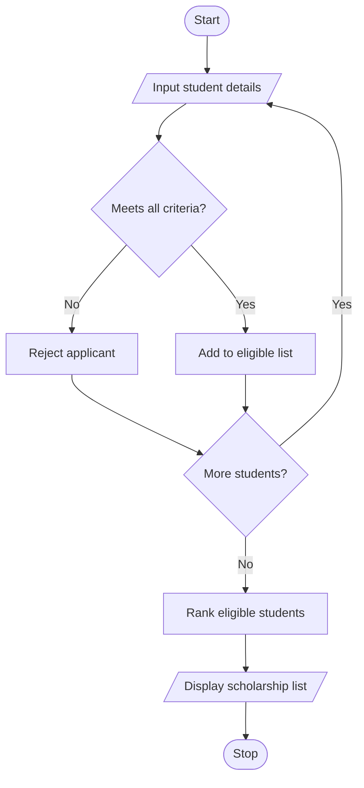

# University Scholarship Allocation System in Python

## 1. Problem Statement

To develop a Python program that evaluates scholarship applicants based on aggregate marks, subject-wise minimum marks, attendance, and family income. The program selects eligible students, ranks them by aggregate marks, and resolves ties using attendance and lower family income.

## 2. Algorithm

1. Start the program.
2. Input the number of students and their details.
3. Check subject-wise minimum marks, aggregate marks, attendance, and income.
4. Select students who satisfy all eligibility criteria.
5. Rank eligible students by aggregate marks, attendance, and lower income.
6. Display the ranked scholarship list.
7. Stop.

## 3. Short Flowchart 

## 5. Sample Input

Enter number of students: 3

Student 1
Name: Ravi
Aggregate marks (%): 85
Enter marks in 3 subjects: 80 75 90
Attendance (%): 90
Family income (Rs): 150000

Student 2
Name: Priya
Aggregate marks (%): 90
Enter marks in 3 subjects: 85 88 92
Attendance (%): 85
Family income (Rs): 180000

Student 3
Name: Arun
Aggregate marks (%): 70
Enter marks in 3 subjects: 65 70 75
Attendance (%): 80
Family income (Rs): 100000

## 6. Sample Output
Eligible Scholarship Students
1 Priya - Marks: 90.0 Attendance: 85.0 Income: 180000.0
2 Ravi - Marks: 85.0 Attendance: 90.0 Income: 150000.0

Note: The eligibility thresholds used are aggregate marks ≥ 75%, each subject ≥ 60%, attendance ≥ 75%, and annual family income ≤ ₹2,00,000. These are sample rules and can be changed according to university scholarship policies.
