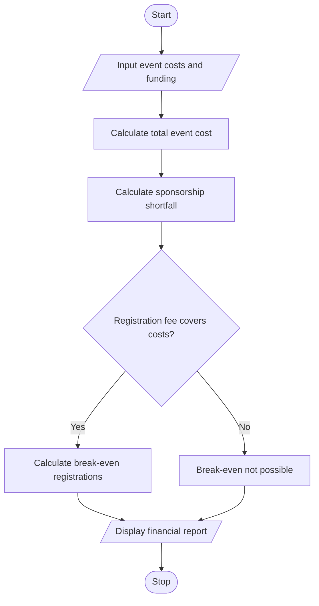

# 10. Campus Event Financial Planning in Python

## 1. Problem Statement

Develop a Python program to calculate campus event expenses, including venue, equipment, catering, transport, and certificates. Determine the participant contribution, calculate the sponsorship shortfall, and find the minimum number of registrations required to break even.

## 2. Algorithm

1. Start the program.
2. Input venue, equipment, and other event costs.
3. Calculate the total fixed cost and cost per participant.
4. Input sponsorship amount and registration fee per participant.
5. Calculate the sponsorship shortfall.
6. Calculate the minimum registrations required to cover all expenses.
7. Display the total budget, participant contribution, sponsorship shortfall, and break-even registration count.
8. Stop.

## 3. Flowchart 

## 5. Sample Input

Enter venue cost (Rs): 10000
Enter equipment cost (Rs): 5000
Enter catering cost per person (Rs): 200
Enter transport cost per person (Rs): 100
Enter certificate cost per person (Rs): 50
Enter expected participants: 100
Enter sponsorship amount (Rs): 10000
Enter registration fee per person (Rs): 500

## 6. Sample Output

--- Campus Event Financial Report ---
Fixed costs: Rs 15000.0
Variable cost per participant: Rs 350.0
Total event cost: Rs 50000.0
Sponsorship: Rs 10000.0
Participant contribution: Rs 50000.0
Sponsorship shortfall: Rs 40000.0
Total funding: Rs 60000.0
Minimum registrations to break even: 46
Status: Event budget covered

