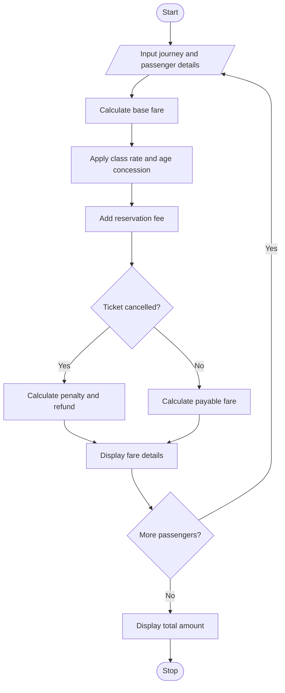

# 6. Railway Fare and Reservation Calculator in Python

## 1. Problem Statement

Develop a Python program to calculate railway fares for multiple passengers based on distance slabs, travel classes, age-based concessions, and reservation fees. If a ticket is cancelled, calculate the cancellation penalty and refund amount. Finally, display the fare details and total amount for all passengers.

## 2. Algorithm

1. Start the program.
2. Input the journey distance and number of passengers.
3. Enter each passenger's name, age, travel class, and cancellation status.
4. Calculate the base fare using distance slabs.
5. Apply the travel class multiplier and age-based concession.
6. Add the reservation fee.
7. If the ticket is cancelled, deduct the cancellation penalty from the paid fare.
8. Display the fare, concession, penalty, and refund details.
9. Display the total amount and stop.

## 3. Flowchart

## 5. Sample Input

Enter journey distance (km): 200
Enter number of passengers: 2

Passenger 1
Enter name: Ravi
Enter age: 25
Enter class (Sleeper/AC3/AC2): Sleeper
Cancel ticket? (yes/no): no

Passenger 2
Enter name: Priya
Enter age: 65
Enter class (Sleeper/AC3/AC2): AC3
Cancel ticket? (yes/no): yes

## 6. Sample Output

Passenger 1

--- Passenger Bill ---
Name: Ravi
Base fare: Rs 300.0
Concession: Rs 0
Reservation fee: Rs 40
Final fare: Rs 340.0
Status: Confirmed

Passenger 2

--- Passenger Bill ---
Name: Priya
Base fare: Rs 600.0
Concession: Rs 240.0
Reservation fee: Rs 40
Cancellation penalty: Rs 100.0
Refund amount: Rs 300.0
Status: Cancelled

Total amount after cancellations: Rs 640.0

