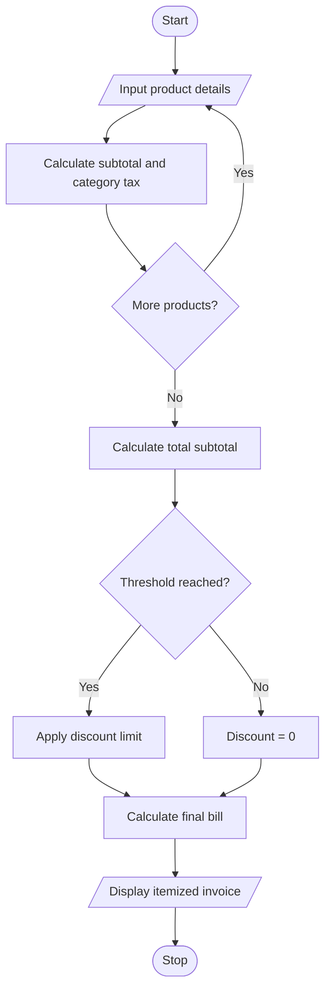

# 7. Retail Billing with Multiple Discount Rules in Python

## 1. Problem Statement

Develop a Python program to generate a retail invoice for multiple products. The program calculates the price based on quantity, applies category-specific taxes, provides discounts when the purchase reaches a specified threshold, and limits the total discount to a maximum concession amount. Finally, it displays an itemized invoice and the total bill.

## 2. Algorithm

1. Start the program.
2. Input the number of products.
3. Enter each product's name, category, price, and quantity.
4. Calculate the subtotal for each product.
5. Apply the category-specific tax rate.
6. Calculate the total subtotal and apply a threshold discount.
7. Limit the discount to the maximum concession amount.
8. Calculate the final bill after discount and tax.
9. Display the itemized invoice.
10. Stop.

## 3. Flowchart 

## 5. Sample Input

Enter number of products: 3

Product 1
Product name: Rice
Category (food/clothing/electronics): food
Price per unit (Rs): 1000
Quantity: 2

Product 2
Product name: Shirt
Category (food/clothing/electronics): clothing
Price per unit (Rs): 1500
Quantity: 2

Product 3
Product name: Headphones
Category (food/clothing/electronics): electronics
Price per unit (Rs): 2000
Quantity: 1

## 6. Sample Output

========== RETAIL INVOICE ==========
Product       Qty   Subtotal   Tax
Rice          2     Rs 2000.00 Rs 100.00
Shirt         2     Rs 3000.00 Rs 150.00
Headphones    1     Rs 2000.00 Rs 360.00
------------------------------------
Subtotal: Rs 7000.0
Total Tax: Rs 610.0
Discount: Rs 700.0
Final Bill: Rs 6910.0
====================================

