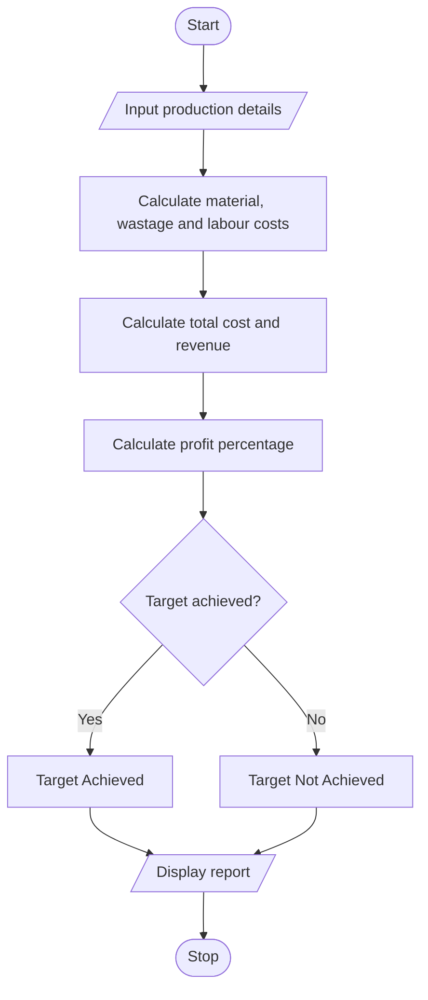

# 8. Manufacturing Cost and Profitability Analysis in Python

## 1. Problem Statement

Develop a Python program to calculate the total manufacturing cost by considering material costs, labour charges, material wastage, and machine costs. Calculate the selling revenue, profit, and profit percentage, then check whether production meets the specified profit target.

## 2. Algorithm

1. Start the program.
2. Input production quantity, material cost, labour cost, wastage percentage, machine cost, selling price, and target profit percentage.
3. Calculate material cost and wastage cost.
4. Calculate total labour cost and total manufacturing cost.
5. Calculate total revenue and profit.
6. Calculate profit percentage.
7. Compare the profit percentage with the target.
8. Display the cost details and target status.
9. Stop.

## 3. Flowchart 

## 5. Sample Input

Enter production quantity: 100
Enter material cost per unit (Rs): 50
Enter labour cost per unit (Rs): 20
Enter wastage percentage: 10
Enter total machine cost (Rs): 500
Enter selling price per unit (Rs): 100
Enter target profit percentage: 20

## 6. Sample Output
--- Manufacturing Report ---
Material Cost: Rs 5000.0
Wastage Cost: Rs 500.0
Labour Cost: Rs 2000.0
Machine Cost: Rs 500.0
Total Manufacturing Cost: Rs 8000.0
Total Revenue: Rs 10000.0
Profit/Loss: Rs 2000.0
Profit Percentage: 25.0 %
Status: Target Achieved

