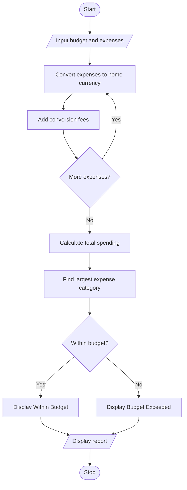

# 9. Multi-Currency Travel Budget Analysis in Python

## 1. Problem Statement

Develop a Python program to calculate travel expenses in different currencies by using supplied exchange rates. Include currency conversion fees, compare total spending with the planned budget, and identify the largest expense category.

## 2. Algorithm

1. Start the program.
2. Input the travel budget in the home currency.
3. Input the number of expense categories.
4. Enter each category's name, expense amount, exchange rate, and conversion fee percentage.
5. Convert each expense into the home currency.
6. Calculate the conversion fee and total expense.
7. Calculate the total travel expenditure.
8. Compare expenditure with the budget.
9. Identify the largest expense category.
10. Display the results and stop.

## 3. Flowchart 

## 5. Sample Input

Enter travel budget in home currency (Rs): 50000
Enter number of expense categories: 3

Expense 1
Enter expense category: Hotel
Enter expense amount: 100
Enter exchange rate (Rs per unit): 85
Enter conversion fee (%): 2

Expense 2
Enter expense category: Food
Enter expense amount: 50
Enter exchange rate (Rs per unit): 85
Enter conversion fee (%): 1

Expense 3
Enter expense category: Shopping
Enter expense amount: 200
Enter exchange rate (Rs per unit): 85
Enter conversion fee (%): 2

## 6. Sample Output

--- Travel Budget Report ---

Category: Hotel
Converted amount: Rs 8500.0
Conversion fee: Rs 170.0
Total expense: Rs 8670.0

Category: Food
Converted amount: Rs 4250.0
Conversion fee: Rs 42.5
Total expense: Rs 4292.5

Category: Shopping
Converted amount: Rs 17000.0
Conversion fee: Rs 340.0
Total expense: Rs 17340.0

Total spending: Rs 30302.5
Travel budget: Rs 50000.0
Largest expense category: Shopping
Status: Within budget
Remaining budget: Rs 19697.5

