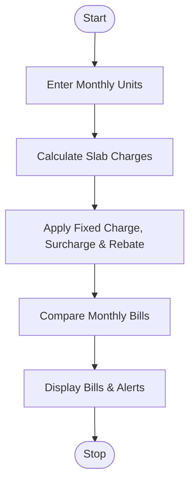

# 2. Progressive Electricity Billing System

## 1. Problem Statement

Write a Python program to calculate monthly household electricity bills using different consumption slabs, fixed charges, surcharges, and rebates. Compare bills across multiple months and identify unusual increases.

Billing Criteria (Example):

| Units Consumed  | Rate per Unit |
| --------------- | ------------- |
| First 100 units | ₹2            |
| Next 100 units  | ₹3            |
| Above 200 units | ₹5            |

- Fixed charge: ₹50 per month
- Surcharge: 5% if consumption exceeds 300 units
- Rebate: 10% if consumption is 100 units or less
- Unusual increase: Bill increases by more than 30% compared to the previous month.

## 2. Algorithm

1. Start the program.
2. Enter the number of months and units consumed.
3. Calculate charges using electricity slabs.
4. Add fixed charges and apply surcharge or rebate.
5. Calculate the final monthly bill.
6. Compare it with the previous month's bill.
7. Display bills and identify unusual increases.
8. Stop.

## 3. Flowchart (Mermaid)

## 5. Sample Input

Enter number of months: 3

Month 1
Enter units consumed: 80

Month 2
Enter units consumed: 150

Month 3
Enter units consumed: 350

## 6. Sample Output

Month 1
Bill: Rs. 189.0

Month 2
Bill: Rs. 400.0
Alert: Unusual bill increase!

Month 3
Bill: Rs. 840.0
Alert: Unusual bill increase!

Monthly Bill Summary
Month 1 : Rs. 189.0
Month 2 : Rs. 400.0
Month 3 : Rs. 840.0

### Bill Calculation

| Month | Units | Final Bill |
| ----- | ----- | ---------- |
| 1     | 80    | ₹189       |
| 2     | 150   | ₹400       |
| 3     | 350   | ₹840       |

Explanation: Month 2 and Month 3 show unusual increases because their bills exceed the previous month's bill by more than 30%.

