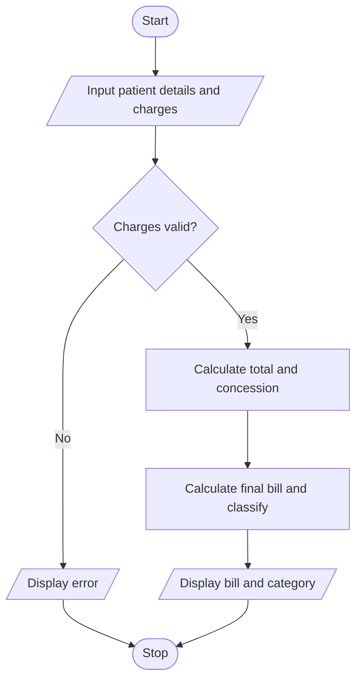

# Hospital Billing and Patient Classification in Python

## 1. Problem Statement

Develop a Python program to calculate a patient's hospital bill by adding consultation, diagnostic, and treatment charges. Apply concessions based on eligibility, validate billing constraints, and classify patients according to their final payment amount.

## 2. Algorithm

1. Start the program.
2. Input the patient's name and consultation, diagnostic, and treatment charges.
3. Validate that all charges are non-negative.
4. Calculate the total bill.
5. Apply a 10% concession if the total bill is ₹10,000 or more.
6. Calculate the final bill after concession.
7. Classify the patient as:
   - Low: Below ₹5,000
   - Medium: ₹5,000 to ₹14,999.99
   - High: ₹15,000 or above
8. Display the bill and patient classification.
9. Stop.

## 3. Flowchart (Mermaid)

## 5. Sample Input

Enter patient name: Ravi
Enter consultation charges: Rs 1000
Enter diagnostic charges: Rs 4000
Enter treatment charges: Rs 7000

## 6. Sample Output

--- Hospital Bill ---
Patient Name: Ravi
Consultation Charges: Rs 1000.0
Diagnostic Charges: Rs 4000.0
Treatment Charges: Rs 7000.0
Total Bill: Rs 12000.0
Concession: Rs 1200.0
Final Bill: Rs 10800.0
Patient Classification: Medium

