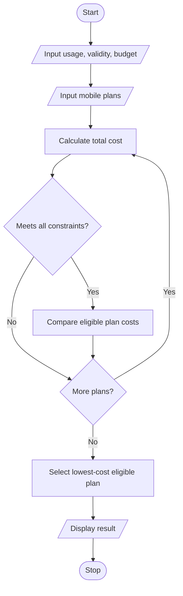

# Multi-Plan Telecommunications Cost Optimization in Python

## 1. Problem Statement

Develop a Python program to compare multiple mobile plans based on data usage, call minutes, validity, and budget. Calculate extra charges when usage exceeds plan limits, identify plans that satisfy all constraints, and select the most economical eligible plan.

## 2. Algorithm

1. Start the program.
2. Input the user's data usage, call minutes, required validity, and budget.
3. Input the details of multiple mobile plans.
4. Calculate each plan's total cost, including excess usage charges.
5. Check whether each plan satisfies the usage, validity, and budget constraints.
6. Select the eligible plan with the lowest total cost.
7. Display plan details and the most economical plan.
8. Stop.

## 3. Flowchart (Mermaid)

## 5. Sample Input

Enter required data (GB): 2
Enter required call minutes: 300
Enter required validity (days): 28
Enter budget (Rs): 300
Enter number of mobile plans: 3

Plan 1
Plan name: Basic
Plan price (Rs): 199
Data limit (GB): 1.5
Call minutes limit: 300
Validity (days): 28
Extra data charge per GB (Rs): 50
Extra call charge per minute (Rs): 1

Plan 2
Plan name: Smart
Plan price (Rs): 249
Data limit (GB): 2.5
Call minutes limit: 400
Validity (days): 28
Extra data charge per GB (Rs): 50
Extra call charge per minute (Rs): 1

Plan 3
Plan name: Premium
Plan price (Rs): 349
Data limit (GB): 5
Call minutes limit: 500
Validity (days): 56
Extra data charge per GB (Rs): 30
Extra call charge per minute (Rs): 1

## 6. Sample Output

Total cost: Rs 224.0
Total cost: Rs 249.0
Total cost: Rs 349.0

--- Result ---
Most economical eligible plan: Smart
Total cost: Rs 249.0

